# DNA 2.0 — Phase 0: Architecture & Security Audit

| | |
|---|---|
| **Status** | Audit complete — specification stage. No feature code was written. |
| **Baseline** | `origin/main` @ `4fac55e` (includes PR #95, "configurable email footer and sign-off") |
| **Method** | Static reading of the repository at that commit. No production system, database, or credential was accessed, tested, or modified. |
| **Companion docs** | [Phase 1 spec](DNA_2.0_PHASE_1_TECHNICAL_SPEC.md) · [Implementation plan](DNA_2.0_IMPLEMENTATION_PLAN.md) · [Roadmap](DNA_2.0_ROADMAP.md) |

**Evidence convention.** Every claim cites `path:line` or a function name at the baseline commit. Claims I could *not* verify from the repository are labelled **Unverified** and listed in §9.

**Scope note on the vision document.** The brief refers to an attached "DNA 2.0 Creator Ecosystem document". It was not present in the environment; the pasted brief was treated as the source of truth. The roadmap should be reconciled against the original document (see Roadmap §0).

---

## 1. Executive summary

1. **There is no creator identity today.** A student is a row in `student_sessions` keyed by `roll_number`. There is no public profile, avatar, bio, links, skills, or username on `main`.
2. **An open PR already starts this work.** PR #84 (`feat/designer-identity-pr1-20261029`, **open, `CONFLICTING`**, based on `f3ff51c`) adds `designer_profiles`, a profile API, an OTP-verified-session guard and a single-column artwork attribution. It has backend only, no UI, and its attribution model (one FK column) cannot express contributors. The Phase 1 spec **builds on it rather than duplicating it** (see Spec §3.1).
3. **"Artwork" means two unrelated things.** The public **Gallery** (`artworks`) is *admin-curated only* — students cannot upload to it — and every row is public. Student creative work lives in the private **Workspace** (`assets`, `boards`). There is no path from a student's work to a public page. Phase 1 must create that path deliberately.
4. **Storage is one public bucket addressed by unguessable UUID paths** (no signed URLs). "Private" workspace assets are private only because their URL is secret. This dictates that *publishing must copy the file to a separate public key* rather than flip a flag.
5. **Identity is weaker than it looks.** Registration accepts any roll number plus any `@iitk.ac.in` mailbox; the first student to verify a roll number owns it. The "name" is self-declared. Anything we call "verified" must be defined precisely (Spec §4.2).
6. **Security findings need action before Phase 1 ships** — chiefly credential-like material committed to this public repository (SEC-01, location withheld here), 45 real roll numbers and names in source (SEC-02), spoofable comment authorship (SEC-04), and the roll-number claim weakness (SEC-03). See §7.

---

## 2. Application architecture

### 2.1 Topology

```
Browser (React 18 SPA, Vite, react-router 7)           Vercel  → www.dnaiitk.site
   │  Authorization: Bearer <JWT>  (VITE_API_BASE_URL + /api)
   ▼
Express API (TypeScript, zod, helmet, cors)            Render  (auto-deploy from main)
   │  + WebSocket realtime (tldraw sync) on same http.Server
   ├── Postgres via `pg` Pool  ───────────────────────  Supabase (pooler)
   └── Storage via StorageProvider ───────────────────  Supabase Storage bucket (public) | local disk (dev only)
Email: Resend (OTP, welcome, reminders, Email Centre)
Scheduler: external cron → POST /api/internal/tick
```

Sources: `package.json`, `vercel.json`, `backend/src/app.ts:60-208`, `backend/src/server.ts:1-37`, `backend/src/storage/index.ts:61-80`, `backend/.env.example`, `.github/workflows/ci.yml`. Hosting facts (Vercel + Render + Supabase) are also recorded in `DEPLOYMENT.md`; I did not verify the live hosts.

### 2.2 Frontend

| Concern | Evidence |
|---|---|
| Router | `createBrowserRouter` in `src/app/routes.tsx:38-76`. Public pages are children of `Root`; the private workspace is a pathless layout route `WorkspaceShell` (`routes.tsx:63-73`) wrapping `/home /moodboards /assets /projects /projects/:id /templates`. Board canvas `/moodboards/:id` is deliberately outside the shell (`routes.tsx:52-57`). |
| Lazy chunks | `/palette`, `/design-studio`, `/admin` (`routes.tsx:49-51`). |
| Session | `StudentContext` (`src/app/context/StudentContext.tsx`): session object in `localStorage` key `iitk_dna_student_session`; JWT via `setStudentToken/getStudentToken` in `src/app/lib/api.ts`. A stored session without a token is cleared and re-verification is forced (`StudentContext.tsx:104-112`). |
| Data | `AppDataContext` (public content incl. artworks), `api.ts` typed client (`const BASE = VITE_API_BASE_URL + '/api'`, `api.ts:4`). |
| SPA hosting | `vercel.json` rewrites everything to `/index.html`; there is **no SSR**, so per-profile `<meta>`/Open Graph tags cannot be server-rendered (client-side `usePageMeta` only). |
| Route-collision guard | `src/app/deepLinkRoutes.test.ts` + `scripts/check-route-collisions.mjs` fail CI if a top-level client route name matches a built file/dir (the `/assets` incident). **Any new top-level route (e.g. `/designers`) is automatically covered** — but must not collide with `public/` contents. |

### 2.3 Backend

Routers mounted in `backend/src/app.ts:152-180`: `auth, events, artworks, domains, students, team, notify, email (Email Centre), live-sessions, boards, workspaces, assets, asset-collections, projects, templates, notifications, settings, coordinators, internal, realtime` (+ versions/comments when realtime is wired).

Conventions to reuse (not reinvent):

- **Validation:** `zod` per route, `safeParse`, `400 {error}`.
- **Auth:** `requireStudent` / `optionalStudent` (`middleware/studentAuth.ts`) set `req.studentRoll`; `requireAdmin` (`middleware/adminAuth.ts`). Ownership is *always* re-derived from the token, never from a body field (`assets.ts` header comment).
- **Errors:** `{ error: string }` (a few legacy routes use `{ message }`).
- **Rate limits:** per-route `express-rate-limit` plus a global 300 req/min limiter (`app.ts:141-149`); default in-memory store.
- **Migrations:** no migration tool. `initSchema()` (`db/schema.ts`) runs idempotent `CREATE TABLE IF NOT EXISTS` / `ALTER … ADD COLUMN IF NOT EXISTS` on every boot, with one-time data changes gated by `schema_migrations` keys. Feature schemas live in their own modules called from `initSchema` (`assetSharingSchema.ts`, `emailCentreSchema.ts`). `db/dbTarget.ts` refuses DDL against an unintended database. CI proves a fresh DB bootstraps (`scripts/ci-verify-schema.ts`).
- **Tests:** vitest against a **real Postgres** (`backend/tests/setup.ts`), 5 consecutive full-suite runs in CI.

### 2.4 Database provider

PostgreSQL on Supabase, accessed directly through `pg` with `DATABASE_URL` (`db/client.ts`). Supabase is *not* used for auth or PostgREST by the app; it is used for Postgres and Storage only. **Unverified:** whether the Supabase "Data API" (PostgREST) is enabled for this project — see SEC-09.

### 2.5 Authentication & authorization (as built)

| Actor | Mechanism | Evidence |
|---|---|---|
| Student | Email OTP (6-digit, bcrypt-hashed, 10-min TTL, 5 attempts) → HS256 JWT `{typ:'student', roll}`, **90-day TTL**, no server-side revocation | `routes/auth.ts:37-246`, `studentAuth.ts` |
| Student (bypass) | Admin-toggled `student_otp_bypass_enabled`; token has `bypass:true`, **1-day TTL**; only for existing profiles | `auth.ts:269-309` |
| Admin | **One shared password** → `jwt.sign({role:'admin'}, JWT_SECRET, {expiresIn:'8h'})`; hash in `admin_config`; 10 attempts / 15 min | `auth.ts:13-33`, `adminAuth.ts` |
| Scheduler | `X-Tick-Secret` shared secret, timing-safe compare | `routes/internal.ts:16-35` |
| Realtime WS | Same student JWT, verified by `verifyStudentToken` in the upgrade handler | `studentAuth.ts` comment, `realtime/` |

Consequences for Phase 1: there is **one identity key (`roll_number`)**, no individual admin identities, and no claim distinguishing an OTP-verified session from a legacy 90-day token (PR #84 adds `identityVerified`).

### 2.6 Student identity & IIT Kanpur email verification

- Table `student_sessions(roll_number PK, unique_id, registered_at, name, email, welcome_email_sent_at, otp_bypass, last_login)` — `schema.ts:111-115` plus `ALTER`s at `:161-195`.
- Email must end in `@iitk.ac.in` (`auth.ts:68-71`). Roll format `^[0-9]{2}[a-zA-Z0-9]{4,10}$` (`auth.ts:62`).
- **What "verified" means today:** the person controls an `@iitk.ac.in` mailbox at login time. The *name* and the *roll→person binding* are self-declared at registration (`auth.ts:98-106`, `:215-224`).
- Batch is derived from the first two digits of the roll (`students.ts:91-95`, `deriveBatch`) — a heuristic, never stored.
- **There is no department field, and no student roster.**

### 2.7 Admin roles & permissions

Single role. Admin UI is the lazy `AdminPage` (`routes.tsx:51`). Existing admin capabilities relevant here: Gallery CRUD and featuring (`artworks.ts`), Library moderation (hide/restore assets & templates — `status` column, `libraryVisibility.ts:28-33`, `LibraryModerationTab.tsx`), team CRUD (`team.ts`), student overview (`students.ts:103`), Email Centre.

### 2.8 File & image storage

- `StorageProvider` interface: `upload, uploadFile, download, getPublicUrl, delete, list` (`storage/index.ts:9-35`). **No `copy`.**
- Production requires Supabase (`server.ts:26-29`); dev falls back to local disk served from `/uploads` with `Content-Disposition: attachment` (`app.ts:94-109`).
- URLs are **public**; the code states this plainly: *"It does NOT make URLs private: storage URLs are public"* (`storage/index.ts:42-45`).
- Image derivatives (`storage_derivatives`, `storage/derivatives.ts`) produce a 512px thumbnail for library images.
- Key prefixes in use: `gallery/`, `covers/`, `thumbs/`, `team/`, `assets/<workspace>/`, `derived/`.

### 2.9 Creative tools

Design Studio, Palette Studio, Halftone Studio, SVG Converter, Background Remover run **client-side**. Their working files are kept in browser memory or IndexedDB (`image-drafts.ts`: 24-hour retention, 25 MB cap). **No Design Studio/Palette/Halftone/Background-Remover component calls `api.assets`** — the only callers are `AddAssetDialog`, `AssetBrowser`, `ShareAssetDialog`, `AssetsPage`, `BoardPage`, `HomeShellPage`, `LibraryModerationTab`. Tool output therefore reaches the server only if the student downloads it and re-uploads it as an asset. *(Grep run on the baseline; see §9 for scope.)*

### 2.10 Deployment & environment

Backend env: required `DATABASE_URL, JWT_SECRET, ADMIN_PASSWORD`; required in production `RESEND_API_KEY, SUPABASE_URL, SUPABASE_SERVICE_ROLE_KEY` (hard-fails on boot otherwise, `server.ts:4-37`). Optional `CORS_ORIGINS, INTERNAL_TICK_SECRET, RESEND_WEBHOOK_SECRET, DB_SSL_*`. `.env.example` files contain placeholders only. `.gitignore` excludes `.env` and `backend/.env`. CI: backend (typecheck, fresh-schema check, 5× suite) and frontend (vitest, pinned-baseline typecheck, build, route-collision check).

---

## 3. Feature inventory & system relationships

```mermaid
flowchart LR
  SS[student_sessions<br/>roll_number PK] -->|raw roll, no FK| WM[workspace_members]
  WM --> WS[workspaces]
  WS --> B[boards] & A[assets] & P[projects]
  A -->|visibility personal/workspace/community| AG[asset_workspace_grants]
  B --> BI[board_items]
  A -.->|placed on| B
  SS -->|raw roll| AL[artwork_likes]
  AR[artworks<br/>admin-curated, all public] --> AL & AC[artwork_comments]
  SS -->|raw roll| V[student_watched_videos /<br/>student_completed_quizzes]
  D[domains = Academy tracks] --> V
  TM[team_members<br/>admin-managed, NOT linked to students]
```



Most tables reference students by a **raw `roll_number` string with no foreign key** (a deliberate repo convention — see `schema.ts` comments at `:1296-1298`, `:1412-1419`). Foreign keys exist only for workspace/board/asset containment.

| System | Tables | Routes | UI | Notes |
|---|---|---|---|---|
| Workspaces | `workspaces`, `workspace_members` | `/api/workspaces` | `WorkspaceShell` | Personal workspace per owner; roles owner/admin/member |
| Moodboards | `boards`, `board_members`, `board_items`, `board_versions`, `board_comments` | `/api/boards` (+WS) | `MoodboardsPage`, `BoardPage` | `visibility` ∈ `private`/`shared` (never anonymous) |
| Asset Library | `assets`, `asset_collections`, `asset_workspace_grants`, `storage_derivatives` | `/api/assets`, `/api/asset-collections` | `AssetsPage`, `AssetBrowser` | `visibility` personal/workspace/community; community = **signed-in students only** |
| Projects | `projects` | `/api/projects` | `ProjectsPage` | Workspace-scoped grouping of boards; private |
| Gallery | `artworks`, `artwork_likes`, `artwork_comments` | `/api/artworks` | `GalleryPage`, `GalleryPreview` | Admin-curated, public |
| Academy | `domains`, `videos`, `quiz_questions`, `student_*` progress | `/api/domains`, `/api/students/:roll/progress` | `AcademyPage` | Source for future achievements |
| Team | `team_members` | `/api/team` | `TeamPage`, `Team` | Admin-managed; not linked to `student_sessions` |
| Events/Live | `events`, `event_rsvps`, `live_sessions` | `/api/events`, `/api/live-sessions` | `EventsPage` | |

---

## 4. Creator/profile audit

Classification: **1** fully implemented · **2** partial · **3** DB only, no UI · **4** UI only, no backend · **5** not implemented.

| Capability | Class | Evidence / notes |
|---|---|---|
| User account record | 2 | `student_sessions` (`schema.ts:111`). Name/email/roll only; no editable profile. |
| Student profile (editable) | 5 | Only the email-change flow exists (`auth.ts` `change-email/request|verify`). Name cannot be edited. |
| Designer profile | 5 on `main` | Proposed in **open PR #84** (`designer_profiles`, `routes/designers.ts`): backend only, no UI, `CONFLICTING`. |
| Public profile page | 5 | No such route in `routes.tsx`. Closest: `/team` (admin-curated). |
| Unique public username | 5 on `main` | PR #84 `handle` column (unmerged). |
| Profile editing | 5 | — |
| Profile image | 2 | `team_members.photo_path` + `POST /api/team` (admin uploads, jpg/png/webp magic-byte checked, 10 MB, `team.ts:25-31,68-80`). Students have none. |
| Cover image | 5 | `artworks.cover_url` is an *artwork* thumbnail, unrelated. |
| Social links | 2 | `team_members.social_instagram/linkedin/email` (admin-managed). `assets.kind='link'` stores external URLs with good validation (`normalizeLinkUrl`, `assets.ts:99-117`) but is not a social link. |
| Skills / interests | 5 | `domains` (Academy tracks) is the only taxonomy. |
| Department | 5 | Not stored anywhere. |
| Batch | 2 | Derived from roll prefix (`students.ts:91`), admin-overview only. |
| Artwork ownership | 2 | `artworks.artist` is **free text** (`schema.ts:84`). No owner column. `assets.owner_roll` gives ownership for *workspace* files only. |
| Artwork attribution / credits | 5 on `main` | PR #84 adds one nullable `creator_designer_id` + admin-only PATCH. No contributors, roles, or order. |
| Contributors / roles / order | 5 | — |
| Public/private visibility | 2 | Assets: 3-level (`libraryVisibility.ts:38`). Boards: private/shared. **Artworks: none — every row is public.** Profiles: none. |
| Admin moderation | 2 | Library hide/restore exists (`status`); Gallery delete/feature exists; nothing for profiles/credits. |
| Admin identity verification | 5 | No `verified` concept. |
| Reporting | 5 | No report mechanism. |
| Learning progress | 3 | `student_watched_videos`, `student_completed_quizzes` store progress; surfaced only to the student. Precursor for achievements. |

### 4.1 PR #84 — what it contributes and where it falls short

Contributes (worth keeping): `designer_profiles` with `owner_roll UNIQUE → student_sessions ON DELETE RESTRICT`; strict handle regex/length CHECK; an explicit `toProfile` projection that omits `owner_roll`; **`requireVerifiedStudent`** (signed `identityVerified` claim from `/student/verify-otp` only, rejecting bypass and legacy tokens); a security fix gating **email change** behind that guard (otherwise a bypass session could take over an account's mailbox, then OTP-login as a verified user); concurrency-safe admin attribution with an audit trail; and a test suite (counts as reported in the PR description, not re-run here).

Falls short for the brief: single-creator attribution; profile has only `display_name`+`bio`; no visibility control (profiles are readable by anyone with the handle); no media; no UI; audit table fixed to `actor='admin'`; CI-blocked by a frontend typecheck-baseline shift at `AppDataContext.tsx` (its own PR description). Detail and disposition: Spec §3.1.

---

## 5. Artwork & asset audit

### 5.1 Where artwork lives

| Store | Table / key | Who writes | Visible to | Ownership |
|---|---|---|---|---|
| Gallery | `artworks` → `gallery/<uuid>.<ext>`, `thumbs/…webp`, `covers/…jpg` | **Admin only** (`artworks.ts` `POST /`, `requireAdmin`) | **Everyone** (`GET /api/artworks` is public, `SELECT *`, `artworks.ts:102-121`) | `artist` free text; nothing else |
| Workspace assets | `assets` → `assets/<workspace>/<uuid>.<ext>` | Any workspace member (`POST /api/assets`) | Per `visibility`/`status`; `community` = any signed-in student | `owner_roll`, `owner_name` |
| Board canvas files | stored via `canvas-files`, referenced only inside `boards.canvas_data` | Board editors | Board members | None (no row) |
| Tool output | Browser IndexedDB only | — | — | None |

### 5.2 Answers to the brief

- **Where uploaded artwork is stored:** Supabase Storage bucket `dna-media` (default, `supabase.ts:22`), local disk in dev.
- **How records are represented:** `artworks` row with `storage_path`, `media_type ∈ {image,pdf,video}`, `cover_url`, `featured`, `likes`, `notified_at`. Public URL derived at read time (`artworks.ts:84-86`).
- **Belongs to a user?** No (free-text `artist`). Assets do (`owner_roll`).
- **Multiple contributors?** No.
- **Can artwork be made public?** Gallery rows are *always* public; assets can be "community" (signed-in only). **There is no anonymous-public, student-initiated publication path.**
- **Retroactive attribution?** Possible without data loss: leave `artist` untouched and add credits. **No name-matching** (names are self-declared and non-unique; PR #84 reached the same conclusion).
- **Tool outputs → creator?** Not today (§2.9). Phase 3 integration; Phase 1 only needs `source_kind` to leave room.
- **Reuse in projects/moodboards?** Boards place assets via `board_items`/`canvas`; `SaveToMoodboardDialog` is already imported by `GalleryPage` (`GalleryPage.tsx:11`), so Gallery → moodboard exists and will extend naturally to profile works.

### 5.3 Changes needed to connect artwork to creators without duplicating data

1. **Credits become the source of truth** (`artwork_credits`, new) — never a copy of the student record; it references `designer_profiles`, which references `student_sessions`.
2. **`artworks` is extended, not forked.** It already has likes, comments, featuring, thumbnails, notifications, and an admin UI. Add `status`, `source_kind`, `source_asset_id`, `created_by_roll`, `description`, `published_at`.
3. **Publishing copies the file** to a `gallery/`-prefixed key (the bucket is public; flipping a flag on the private key would expose it permanently and for up to a day of CDN cache — `storage/index.ts:37-50`). The asset remains private and untouched.
4. **Every existing reader of `artworks` must filter `status='published'`** before any student-created row exists. Known: `GET /api/artworks` (`SELECT *`), the notification flow (`artworks.notified_at`), storage reference/inventory scanning, `AppDataContext`. The implementation plan's first schema task is this filter. *(The notify/storage readers were identified from column names, not read line-by-line — verify during T5.)*

---

## 6. Reusable components & modules

**Backend:** `requireStudent/optionalStudent/requireAdmin`; zod + `{error}` convention; `lib/diskUpload` (streamed multipart); `lib/uploadLimits`; `sharp` pipeline in `artworks.ts` (`generateThumb`); magic-byte tables in `artworks.ts:63-71` and `team.ts:25-31` (**duplicated — extract**); `normalizeLinkUrl` (`assets.ts:103`, extract to `lib`); `StorageProvider`; `storage/derivatives`; visibility/`status` pattern (`libraryVisibility.ts`); `initXSchema` module pattern; `rateLimit` factories; `rollBinder` helper; admin moderation pattern in `lib/libraryAdmin.ts`.

**Frontend:** `StudentContext`, `useAppData`, `api.ts` client; `ArtworkLightbox`/`ZoomImage`/`useIsNarrowViewport`; `SaveToMoodboardDialog`; `usePageMeta`; `thumbUrl/displayUrl` (`lib/utils`); Radix-based `components/ui/*`; `LibraryModerationTab` as the template for a creator-moderation admin tab; `WorkspaceShell` for the *private* editor entry (not the public profile); the AdminPage lazy chunk already bundles an image cropper (`routes.tsx:19-23` comment — exact component to be located in T10).

**Constraint:** `Navigation.tsx` (public navbar) is not to be modified without the owner's explicit approval (standing project instruction). Entry points to the profile editor are designed around that (Spec §8.4).

---

## 7. Security findings

Severity: **Critical / High / Medium / Low**. Status: **Confirmed** = demonstrated by reading the code path (not exploited against any live system) · **Potential** = depends on configuration or behaviour I could not verify.

> **Handling note.** Per the brief, no secret value appears in this document. For SEC-01 the *location is also withheld here* because this repository is **public** (`gh repo view` → `PUBLIC`): naming the file in a committed document would point readers at it before the credentials are rotated. The location and a redacted description were handed to the maintainer separately in the task report. Rotation and history handling are the maintainer's action; this task did not rotate anything.

| ID | Sev | Status | Finding | Location | Recommended remediation |
|---|---|---|---|---|---|
| **SEC-01** | **Critical** | Confirmed (present); **Unverified** (whether values are live) | A tracked, publicly visible markdown file reproduces what it describes as production secrets: the JWT signing secret, the admin password and a database connection password. The JWT secret it quotes is weak. If live, anyone can forge admin tokens and read/write the database. | Withheld — see handling note | **Rotate** JWT secret, admin password, and DB password; assume compromise. Remove the content from the tree (history still holds it — rotation, not deletion, is the fix). Enforce a minimum `JWT_SECRET` length at boot (today only presence is checked, `server.ts:4-10`). Add secret scanning to CI. |
| **SEC-02** | High | Confirmed | 45 real roll numbers with student names are hard-coded in source and seeded into `audience_group_members`; the repo is public. | `backend/src/db/schema.ts:531-577` | Remove from source; seed from an admin-uploaded roster or env-supplied file. Consider the data already public. |
| **SEC-03** | High | Confirmed (code path) | **Roll-number squatting.** Registration trusts a client-supplied roll + any `@iitk.ac.in` mailbox; OTP proves only mailbox control. Whoever registers an unclaimed roll first owns it; the real student later receives OTPs at the squatter's mailbox. | `auth.ts:85-106, 215-224` | Product decision: admin roster import binding roll → expected name/email; or admin "verified" review for first login. Until then, Phase 1 treats names as self-declared and gates the *Verified* badge on admin action (Spec §4.2). |
| **SEC-04** | High | Confirmed | **Comment author spoofing.** `sender` comes from the request body, not the token; any signed-in student can post as anyone. | `artworks.ts:361-376`; client sends `studentSession.name` (`GalleryPage.tsx:119`) | Derive `sender` server-side from the authenticated student (later: profile display name). Matters more once names link to profiles. |
| **SEC-05** | Medium | Confirmed | Stateless 90-day student JWT with no revocation; a removed/abusive student keeps access until expiry. Bypass tokens are 1 day. | `studentAuth.ts` (`STUDENT_TOKEN_TTL`) | Add a per-student `tokens_valid_after` check (single indexed read) before launch of public profiles; PR #84's `identityVerified` claim is a partial step. |
| **SEC-06** | Medium | Confirmed | Single shared admin identity; no per-admin attribution in audit trails (PR #84 records actor as the literal `'admin'`). | `auth.ts:21-33`, `adminAuth.ts` | Out of Phase 1 scope; flagged as debt that grows with moderation volume. Audit-log schema (Spec §4) leaves `actor` extensible. |
| **SEC-07** | Medium | Confirmed | `POST /api/internal/tick` accepts the secret via **query string** (`?secret=`) as well as header; query strings are logged by proxies/CDNs. | `routes/internal.ts:29` | Accept header only; rotate after change. |
| **SEC-08** | Medium | Confirmed | Public roll-number enumeration oracle: `GET /api/students/:roll/exists` distinguishes registered/unregistered rolls (30 req / 5 min / IP). | `students.ts:32-49` | Needed for login UX; keep rate limit, consider uniform responses. Relevant because profiles must never reveal rolls. |
| **SEC-09** | Medium | **Potential** | If the Supabase Data API (PostgREST) is enabled and tables lack Row Level Security, the anon key could read tables such as `student_sessions` (emails). No RLS statements were found in the schema modules read (`schema.ts`, `assetSharingSchema.ts`, `designerSchema.ts` in PR #84); `emailCentreSchema.ts` and the rest of the codebase were not exhaustively searched. | `db/*` | Check Supabase dashboard: disable Data API or enable RLS with no policies on every table. **Do not change production from this task.** |
| **SEC-10** | Medium | **Potential** | Public bucket + secret-URL privacy: any leaked asset URL stays fetchable after "unpublish"/delete until CDN cache expires (documented, `storage/index.ts:37-50`). | `storage/*` | Architectural: Phase 1 publishes by **copy** (never exposes private keys); consider private bucket + signed URLs for workspace assets later. |
| **SEC-11** | Low–Med | **Potential** | `image/svg+xml` assets are stored and served inline from the public storage origin (`assets.ts` `ASSET_MIME_EXT`, `toPublicAsset`). Direct navigation to an SVG URL can execute script in the *storage* origin (not the app origin). | `assets.ts:91-97, 207-209` | Never publish SVG in Phase 1; render user SVG only via ``; or sanitize/rasterize. |
| **SEC-12** | Low | Confirmed | Gallery PDF viewer sends the file URL to `docs.google.com/viewer` (third party). | `GalleryPage.tsx:68` | Prefer `<object>`/pdf.js self-hosted; note for privacy copy. |
| **SEC-13** | Low | Confirmed | Rate limiters use the default per-process memory store; limits reset on restart and are per-instance. | `app.ts:141-149` and per-route | Acceptable single-instance; revisit if scaled. |
| **SEC-14** | Info | Confirmed | `GET /api/artworks` returns every artwork **and every comment** in one unpaginated response, `SELECT *`. Any new column is automatically public. | `artworks.ts:102-121` | Replace `SELECT *` with an explicit public projection as part of Phase 1 (T5). |

**Positive controls observed** (preserve them): helmet; CORS allowlist with `403` for unknown origins (`app.ts:64-89`); small JSON body limits; bcrypt OTP storage with attempt caps; magic-byte validation on gallery/team uploads; extension allowlist + `application/octet-stream` for general assets; link validation rejecting credentials/non-http(s) (`assets.ts:103`); `Content-Disposition: attachment` on `/uploads`; boot refusal for missing prod secrets and for DDL against the wrong DB target; scheduler secret compared timing-safe; account-email change gated by OTP to the *new* address.

**Secrets handling checks run:** tracked files matching `.env*` are the two `.env.example` files (placeholders only); no tracked file other than the one in SEC-01 matched secret-shaped literal patterns; test/CI database URLs are disposable local credentials.

---

## 8. Technical debt relevant to this milestone

| Debt | Impact on Phase 1 |
|---|---|
| Raw `roll_number` strings with no FK across most tables (e.g. `assets.owner_roll`, `boards.owner_roll`, `artwork_likes`, `notifications.recipient_roll`) | New tables follow convention for *ownership of private content*, but **profile → `student_sessions` gets a real FK** (identity anchor). |
| Duplicated upload validators (`artworks.ts`, `team.ts`) | Extract once before adding a third (profile images). |
| Gallery `SELECT *` + unpaginated comments | Must become explicit/paginated before student content exists. |
| Mixed error shapes `{error}` / `{message}` | New routes use `{error}`. |
| Frontend typecheck has a pinned baseline of unrelated diagnostics (`scripts/check-studio-types.mjs`); line-number shifts fail CI (PR #84) | Plan avoids adding fields to `AppDataContext.tsx:~429`; new types go in new files. |
| In-memory rate limits | Acceptable now. |
| No individual admin identity | Audit log `actor` kept extensible. |
| `schema.ts` is 1,755 lines, DDL on every boot | New schema in its own `designerSchema.ts` module (existing pattern), transactional. |
| Many registered git worktrees, 13 of them already listed as `prunable` (missing directories) | Housekeeping only (`git worktree prune`); not touched here. |

---

## 9. Verification limits (what this audit did not do)

- No access to production, Supabase dashboard, Render, Vercel, or Resend; hosting configuration, RLS, bucket policy, and CDN behaviour are **Unverified**.
- No dynamic testing or exploitation; "Confirmed" means the code path is unambiguous when read.
- The "tools do not call `api.assets`" conclusion rests on a repository-wide search for the identifier `api.assets`; indirect paths (e.g. a generic `fetch`) were not exhaustively excluded.
- `emailCentreSchema.ts`, `notify.ts`, `storage/references.ts`, `storage/inventory.ts`, most of `boards.ts`, and the frontend admin tabs were not read line-by-line.
- The attached vision document was unavailable.
