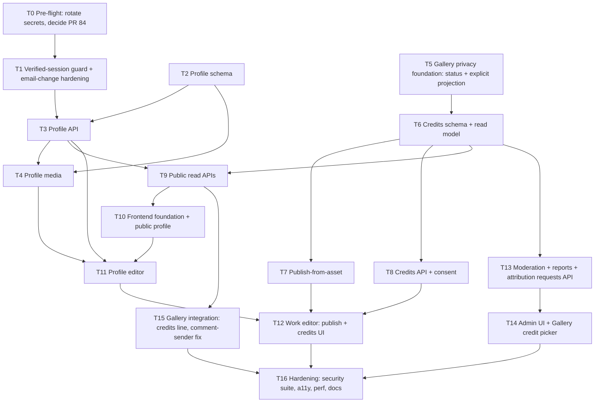

# DNA 2.0 — Phase 1 Implementation Plan

| | |
|---|---|
| **Status** | Proposed |
| **Spec** | [Phase 1 technical spec](DNA_2.0_PHASE_1_TECHNICAL_SPEC.md) · **Audit** [findings](DNA_2.0_ARCHITECTURE_AUDIT.md) |
| **Granularity** | One task ≈ one PR (≤ ~600 changed lines excluding tests), independently testable and deployable behind "no UI yet" |

## Progress

Decisions D1 (reuse PR #84), D2 (workspace-sidebar entry point) and D3 (privacy/publication) were confirmed by the maintainer. Evidence: [verification record](verification/PHASE_1_FOUNDATION_VERIFICATION.md); owner actions: [security remediation checklist](SECURITY_REMEDIATION_CHECKLIST.md).

| Task | State | Notes |
|---|---|---|
| T0 | **Owner action outstanding** | Credential rotation and Supabase Data API/RLS check need provider access; nothing is claimed rotated. |
| T1 | Done (PR #84) | Verified-session guard + email-change hardening, ported onto current `main`. |
| T2 | Done | `designer_profiles` (extended), links, disciplines, `creator_audit_log`. |
| T3 | Done (API) | Owner + public + preview + visibility + links/skills/disciplines. Media upload is T4. |
| T4 | Not started | Profile media. |
| T5 | Done | `status`, explicit projection, `GET /:id`, admin list, notify guard. The `status` default flip to `'draft'` is a deliberate follow-up deploy (spec §6.4). |
| T6 | Done | `artwork_credits`; `attribution_requests` and `content_reports` intentionally deferred (no UI to raise them yet). |
| T7 | **Not started — student publishing is not enabled** | Unblocked by T5. |
| T8 | Partial | Admin add/edit/remove/invite and the credited person's accept/decline. Student-initiated invites need T7. |
| T9 | Done | Public profile + works list with the visibility matrix. |
| T10–T12, T14, T15 | Not started | Frontend; sidebar "My Profile" entry lands with the editor (D2). SEC-04 comment-sender fix from T15 is done. |
| T13 | Partial | Admin hide/verify (profiles), hide/restore (artworks), audit. Reports and attribution requests deferred. |
| T16 | Not started | |

## Conventions that apply to every task

- **Branch/PR:** one feature branch per task from current `origin/main`; squash-merge. Never `git add -A`; stage named files.
- **Backend tests:** vitest against real Postgres (`backend/tests/*.test.ts`, `setup.ts` truncates tables you touch — add new tables to that list). CI runs the suite five times; tests must be order-independent and deterministic.
- **Schema:** only in `backend/src/db/designerSchema.ts` (T2/T5/T6), idempotent, transactional, called from `initSchema()`. `ci-verify-schema.ts` is extended to assert the new objects exist on a fresh DB.
- **Frontend:** new types/calls in new files; do not grow `AppDataContext.tsx` (pinned-typecheck baseline). `pnpm vitest run`, `pnpm run typecheck:studio`, `pnpm vite build`, `node scripts/check-route-collisions.mjs` must pass.
- **Do not touch:** `Navigation.tsx`, `PaletteStudio.tsx` generation code, production settings.
- **Package managers:** frontend `pnpm`, backend `npm`.

## Dependency graph

**Recommended order (minimises architectural debt):** T0 → **T5** (close the leak path first) → T1 → T2 → T3 → T6 → T9 → T4 → T10 → T11 → T7 → T8 → T12 → T13 → T14 → T15 → T16. Rationale: the Gallery must stop trusting `SELECT *` *before* any student-created row can exist; the OTP-verified guard must exist before any identity write; read models precede writes; UI follows stable APIs; moderation lands before the public launch, not after.

**Launch gate:** do not switch any profile to a discoverable state in production until T0, T5, T13 and T16 are done.

---

## T0 — Pre-flight decisions & security prerequisites *(no code, maintainer actions)*

| | |
|---|---|
| **Objective** | Remove blockers that code cannot fix. |
| **Dependencies** | None |
| **Actions** | (1) **Rotate** the JWT secret, admin password and DB password (audit SEC-01); redeploy Render. (2) Decide D1–D6 (spec §14), esp. disposition of PR #84. (3) In the Supabase dashboard confirm Data API is off or RLS is enabled (SEC-09). (4) Confirm whether the attached vision document differs from the brief (Roadmap §0). |
| **Tests / acceptance** | Written confirmation of each. Nothing merges to production from this plan before (1). |

## T1 — Verified-session guard + email-change hardening

| | |
|---|---|
| **Objective** | Introduce a signed `identityVerified` claim and `requireVerifiedStudent`; close the bypass → email-change takeover. |
| **Dependencies** | T0 decision D1 |
| **Files** | `backend/src/middleware/studentAuth.ts`, `backend/src/routes/auth.ts`, `backend/tests/email-change-security.test.ts` (port from PR #84), `backend/tests/otp-auth.test.ts` |
| **Backend** | Add `identityVerified?: true` to `StudentClaims`; `signStudentToken` (called only from `verify-otp`) sets it; add `verifyStudentClaims` (copies only understood claims; never infers verification from absent `bypass`); `requireVerifiedStudent` → `401` no token, `403` bypass/legacy. Apply to `change-email/request` and `/verify`. `verifyStudentToken` keeps its signature (realtime depends on it). |
| **Frontend** | None. (Existing tokens lack the claim → those users re-login before editing; reads unaffected.) |
| **DB** | None |
| **Tests** | Bypass token cannot start or finish an email change (even with a pre-existing challenge); legacy 90-day token → `403`; OTP-issued token passes; full bypass → change-email → OTP login → write sequence fails at step 2; realtime WS still authenticates. |
| **Acceptance** | All of the above green; no change to login UX; bypass login still works for ordinary routes. |

## T2 — Profile schema

| | |
|---|---|
| **Objective** | Create `designer_profiles`, `designer_profile_disciplines`, `designer_profile_links`, `creator_audit_log`. |
| **Dependencies** | None (can run parallel to T1) |
| **Files** | `backend/src/db/designerSchema.ts` (new), `backend/src/db/schema.ts` (one call), `backend/scripts/ci-verify-schema.ts`, `backend/tests/setup.ts` (truncate list), `backend/tests/designer-migration.test.ts` |
| **DB** | Spec §4.1–4.3, §4.8. FK `owner_roll → student_sessions ON DELETE RESTRICT`. Single transaction; re-runnable. |
| **Tests** | Fresh-DB bootstrap; second run is a no-op; constraint tests (handle regex/length, one profile per roll, link position uniqueness, `visibility` default `private`); FK blocks deleting a student with a profile. |
| **Acceptance** | `ci-verify-schema` asserts all four tables; no existing test changes behaviour. |

## T3 — Profile API (owner endpoints)

| | |
|---|---|
| **Objective** | `GET/POST/PATCH /designers/me`, `handle-available`, `PUT links|disciplines|skills`, `PATCH visibility`, `GET /designers/me/preview`. |
| **Dependencies** | T1, T2 |
| **Files** | `backend/src/routes/designers.ts`, `backend/src/app.ts` (mount), `backend/src/lib/designerValidation.ts` (handle/reserved/skills/links), `backend/src/lib/linkUrl.ts` (extract `normalizeLinkUrl` from `assets.ts`; keep `assets.ts` re-export so its tests don't move), `backend/tests/designers.test.ts` |
| **Backend** | Spec §7–8.1. Static routes before `/:handle`. `strict()` zod everywhere. Explicit serializers `toOwnerProfile`/`toPublicProfile`. Handle rename throttle. `display_name` vs verified-name guard. Disciplines validated against `domains` inside a transaction (`FOR UPDATE` on profile row to cap at 3). |
| **Frontend** | None |
| **Tests** | Spec §9.5 items 2, 3, 10; link validation matrix (`javascript:`, `http:`, userinfo, host/kind mismatch, IP literal); skills normalisation; discipline cap under concurrency; serializer never emits forbidden fields; rate limits. |
| **Acceptance** | Owner can create/edit a private profile via API only; no endpoint accepts a profile id for self-routes. |

## T4 — Profile media

| | |
|---|---|
| **Objective** | Avatar/cover upload with safe processing. |
| **Dependencies** | T2, T3 |
| **Files** | `backend/src/lib/imageMagic.ts` (extract from `team.ts` + `artworks.ts`; both import it), `backend/src/routes/designers.ts`, `backend/tests/designer-media.test.ts` |
| **Backend** | Spec §5. `diskUploadSingle`; `sharp` rotate→resize→webp→**no metadata**; key `profiles/<id>/<uuid>.webp`; compensating delete on DB failure; delete old object after success; `415/413/422`. |
| **Tests** | JPEG with GPS EXIF → output has no EXIF; SVG/GIF/polyglot rejected; oversize `413`; DB failure leaves no orphan object (use local storage provider); replace deletes old key. |
| **Acceptance** | `team.ts` and `artworks.ts` behaviour unchanged (their existing tests pass after the extraction). |

## T5 — Gallery privacy foundation *(do this first after T0)*

| | |
|---|---|
| **Objective** | Make it structurally impossible for a non-published artwork to reach a public response. |
| **Dependencies** | T0 |
| **Files** | `backend/src/db/designerSchema.ts` (artworks columns, step 1 of §6.4), `backend/src/routes/artworks.ts`, `backend/src/routes/notify.ts` (if it selects artworks), `backend/src/storage/references.ts` / `inventory.ts` (verify), `backend/tests/artworks-visibility.test.ts` |
| **Backend** | Add `status, source_kind, source_asset_id, created_by_roll, description, published_at` (default `status='published'`). Replace `SELECT *` in `GET /artworks` with an explicit column list + `WHERE status='published'`; admin insert passes `status='published'` explicitly; add `GET /artworks/admin/list` (unfiltered) and switch the admin UI's data source to it. **Audit every reader of `artworks`** (known candidates listed in audit §5.3 item 4) and add the filter or confirm it is admin-only. Add `GET /artworks/:id`. |
| **Frontend** | Admin Gallery tab reads from `/artworks/admin/list`. Public pages unchanged. |
| **DB** | Spec §4.4. |
| **Tests** | Insert a `draft` and a `hidden` row directly → absent from `GET /artworks`, `/artworks/:id` (404), notify recipients/previews; present in admin list; legacy rows remain published and unchanged; ordering unchanged. |
| **Acceptance** | Existing Gallery, home preview and admin flows behave identically; test proves a draft cannot leak through any enumerated reader. |
| **Follow-up** | Separate small PR **after** the deploy is live: flip `status` default to `'draft'` (spec §6.4). |

## T6 — Credits schema + read model

| | |
|---|---|
| **Objective** | `artwork_credits`, `attribution_requests`, `content_reports`; credit serialisation with visibility rules. |
| **Dependencies** | T2, T5 |
| **Files** | `designerSchema.ts`, `backend/src/lib/credits.ts` (`publicCredits(artworkIds)`: accepted-only, link only when profile public ∧ active), `backend/tests/credits-model.test.ts` |
| **DB** | Spec §4.5–4.7: partial unique index for primary, `UNIQUE(artwork_id, profile_id)`, `CHECK (NOT is_primary OR role='creator')`. |
| **Tests** | Constraint tests; `publicCredits` omits pending/declined, omits `handle` for non-public/hidden profiles, orders by `position`; batch query is one round-trip (no N+1). |
| **Acceptance** | Library function used by T9/T15; no route yet. |

## T7 — Publish from asset

| | |
|---|---|
| **Objective** | `POST /works`, `PATCH`, `publish`, `unpublish`, `DELETE`, `GET /works/mine`. |
| **Dependencies** | T3, T5, T6 |
| **Files** | `backend/src/routes/works.ts`, `backend/src/lib/galleryThumb.ts` (extract `generateThumb`), `backend/src/lib/imageMagic.ts`, `backend/tests/works.test.ts` |
| **Backend** | Spec §6.1–6.2. Re-check magic bytes on downloaded bytes; reject SVG; ≤25 MB; copy via `download`+`uploadFile` to `gallery/<uuid>.<ext>`; thumb; insert artwork + primary credit in one transaction with compensating storage delete; limits (20 drafts/100 published/10 per hour). **Never** set `notified_at`; never call the notify flow. |
| **Tests** | Spec §9.5 items 4, 5, 9; copy independence (deleting/unsharing the asset does not break the work; unpublishing does not touch the asset); other member's community asset → rejected; private asset's `storage_key` never in any response; limits; failure mid-way leaves no orphan object or row. |
| **Acceptance** | A student can publish and unpublish an owned image asset; `assets` rows are never modified. |

## T8 — Credits API + consent

| | |
|---|---|
| **Objective** | Add/reorder/remove credits; accept/decline; attribution requests (student side). |
| **Dependencies** | T6, T7, notifications service |
| **Files** | `backend/src/routes/works.ts`, `backend/src/services/notificationService.ts` (new notification type; keep existing mapping comment accurate), `backend/tests/credits-api.test.ts` |
| **Backend** | Spec §6.5, §8.3. Creator-only mutations (`404` for others); credited-profile-only respond; cap 10; cannot change primary; notification on invite. |
| **Tests** | §9.5 items 7, 8; self-remove allowed; invite to hidden/nonexistent profile rejected; concurrent adds. |
| **Acceptance** | Full credit lifecycle via API; pending credits never public. |

## T9 — Public read APIs

| | |
|---|---|
| **Objective** | `GET /designers/:handle`, `GET /designers/:handle/works`, credits embedded in artwork responses. |
| **Dependencies** | T3, T6 |
| **Files** | `backend/src/routes/designers.ts`, `backend/src/routes/artworks.ts`, `backend/tests/designers-public.test.ts` |
| **Backend** | Visibility matrix (spec §9.1) in one `canViewProfile(viewer, profile)` function with unit tests; keyset pagination; `optionalStudent`; uniform `404`; response `Cache-Control: no-store` for `members`-capable responses, short public cache only for anonymous-visible. |
| **Tests** | Full matrix; work grid contains only published ∧ accepted; hidden profile → none of its media/links anywhere; forbidden-field test; pagination stability under inserts. |
| **Acceptance** | Public JSON contains none of the fields in spec §9.4. |

## T10 — Frontend foundation + public profile page

| | |
|---|---|
| **Objective** | Route, API client, `PublicProfilePage`, `WorksGrid`, states. |
| **Dependencies** | T9 |
| **Files** | `src/app/lib/designers.ts`, `src/app/types/designers.ts`, `src/app/pages/PublicProfilePage.tsx`, `src/app/components/designers/*` (ProfileHeader, DisciplineChips, ProfileLinks, WorksGrid, WorkCard, states), `src/app/routes.tsx` (lazy route), tests |
| **Frontend** | Spec §11.1–11.3. Lazy chunk. Skeleton/Not-found/Error(retry). `usePageMeta`. Text-only rendering of bio. Reduced-motion. No change to `Navigation.tsx`. |
| **Tests** | Component tests (empty, error, not-found, 0/1/many works, long names, missing images); link `rel` attributes; `deepLinkRoutes` + `check-route-collisions` pass; snapshot of mobile 320/375 and desktop 1440 in light/dark (manual screenshots recorded in the PR as in prior `docs/*/` verification practice). |
| **Acceptance** | A seeded public profile renders at `/designers/:handle` with no console errors and no horizontal scroll at 320 px. |

## T11 — Profile editor

| | |
|---|---|
| **Objective** | Create/edit profile, upload images, manage disciplines/skills/links, visibility with preview. |
| **Dependencies** | T3, T4, T10 |
| **Files** | `src/app/pages/ProfileEditorPage.tsx`, `src/app/components/designers/editor/*`, `routes.tsx` (child of `WorkspaceShell`), workspace sidebar entry (**not** `Navigation.tsx`), tests |
| **Frontend** | Spec §11.2, §11.4: handle availability (debounced), OTP-required notice for non-verified sessions, dirty-state/save bar, draft kept in `localStorage` with try/catch, visibility confirm showing the preview. |
| **Tests** | Validation parity with server rules (shared constants); failure states (409, 429, 413/415, network); keyboard-only flow; a11y checks (labels, `aria-describedby`, focus management on error). |
| **Acceptance** | End-to-end on a local stack: new student creates profile → private → preview → public → profile visible logged-out. |

## T12 — Work editor (publish + credits UI)

| | |
|---|---|
| **Objective** | Publish an asset as a work; manage credits; respond to credit invites. |
| **Dependencies** | T7, T8, T11 |
| **Files** | `src/app/pages/WorkEditorPage.tsx`, `src/app/components/designers/work/*`, `AssetBrowser` picker mode (image-only, mine-only prop), tests |
| **Frontend** | Spec §11.2: explicit publish panel listing what becomes public; credits editor with keyboard reorder; pending/accepted/declined chips; unpublish/delete confirms. |
| **Tests** | Component + integration (mock API); publish disabled until preconditions met; error mapping; focus order. |
| **Acceptance** | Full journey 2 and 3 (spec §12) works against a local backend. |

## T13 — Moderation, reports, attribution requests (API)

| | |
|---|---|
| **Objective** | Admin hide/verify/credit-edit endpoints, reports, attribution-request resolution, audit writes. |
| **Dependencies** | T6, T8 |
| **Files** | `backend/src/routes/designers.ts` (admin section), `backend/src/routes/artworks.ts`, `backend/tests/creator-moderation.test.ts` |
| **Backend** | Spec §8.4, §10. Every admin mutation writes `creator_audit_log` in the same transaction. Approving a request inserts the credit atomically. |
| **Tests** | §9.5 items 12, 13; student token → `401`; hide is reversible and removes media/links/credits' links from public output; audit rows written exactly once for no-op repeats. |
| **Acceptance** | An admin can resolve a report end to end by API. |

## T14 — Admin UI

| | |
|---|---|
| **Objective** | Creators tab (Profiles / Reports / Attribution) and Gallery credit picker. |
| **Dependencies** | T13 |
| **Files** | `src/app/components/admin/CreatorsTab.tsx` (modelled on `LibraryModerationTab.tsx`), `AdminPage.tsx` registration, Gallery admin form credit picker |
| **Tests** | Component tests; manual: attribute a legacy artwork and see the credit line publicly; confirm `artist` text unchanged. |
| **Acceptance** | Legacy attribution possible without name-matching; every action leaves an audit row. |

## T15 — Gallery integration + comment-sender fix

| | |
|---|---|
| **Objective** | Credit line in the Gallery modal/cards; fix SEC-04. |
| **Dependencies** | T9 |
| **Files** | `GalleryPage.tsx` (credit line only), `artworks.ts` (derive `sender` server-side), `src/app/lib/designers.ts`, tests (`comment-security.test.ts` neighbours) |
| **Tests** | Body `sender` ignored; credit text vs link per visibility; legacy `artist` fallback. |
| **Acceptance** | No visual regression for artworks without credits. |

## T16 — Hardening & release readiness

| | |
|---|---|
| **Objective** | Whole-feature verification before enabling for students. |
| **Dependencies** | T12, T14, T15 |
| **Work** | Run the full spec §9.5 security suite (collected in one `creator-privacy.test.ts` regression file); a11y pass (keyboard + screen-reader spot checks, 320/375/768/1440, light/dark); performance check (public profile with 48 works: image sizes, no N+1 — query count asserted in test); update `README`/`DNA_CLUB_DOCS.md`; record verification evidence under `docs/dna-2.0/verification/`; flip `artworks.status` default to `'draft'` if not yet done; rollback notes. |
| **Acceptance** | CI green (5× backend); manual QA checklist signed off; launch gate satisfied (T0, T5, T13, T16). |

---

## Rollout & rollback

- **Order of deploys:** backend first (schema is additive; new routes inert), frontend second. Every task is safe to ship alone because no UI links to unfinished backends.
- **Feature flag:** none needed — profile pages exist only for profiles with `visibility != 'private'`, which no one has until T11 ships. A `DESIGNERS_ENABLED` env kill switch (503 on `/designers*`, `/works*`) is cheap insurance and recommended for T3.
- **Rollback:** schema is additive; code rollback leaves unused tables/columns harmlessly. Published copies in `gallery/` are ordinary Gallery objects and remain valid. Unpublish/hide are the operational rollbacks.

## Estimation (indicative)

T0 external · T1 S · T2 S · T3 M · T4 M · T5 M · T6 S · T7 M · T8 M · T9 M · T10 M · T11 L · T12 L · T13 M · T14 M · T15 S · T16 M. (S ≈ 0.5–1 day, M ≈ 1–2 days, L ≈ 3–4 days of focused work.) Critical path: T0 → T5 → T2/T3 → T6 → T9 → T10 → T11 → T12 → T16.
