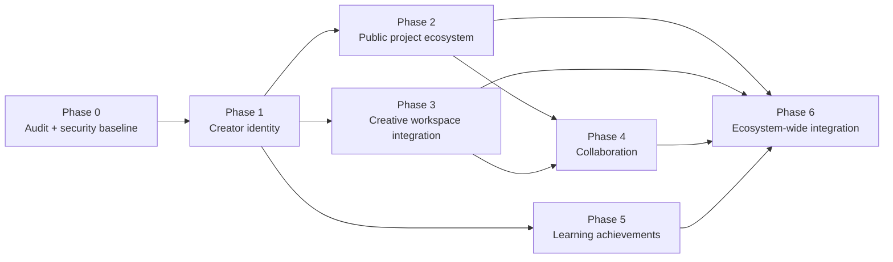

# DNA 2.0 — Creator Ecosystem Roadmap

| | |
|---|---|
| **Status** | Proposed sequence; Phase 0 and Phase 1 are specified in detail, Phases 2–6 are outlines. |
| **Companion docs** | [Audit](DNA_2.0_ARCHITECTURE_AUDIT.md) · [Phase 1 spec](DNA_2.0_PHASE_1_TECHNICAL_SPEC.md) · [Implementation plan](DNA_2.0_IMPLEMENTATION_PLAN.md) |

## 0. Provenance and reconciliation

The brief refers to an attached "DNA 2.0 Creator Ecosystem document" that was **not available** when this roadmap was written. The vision and six areas below are taken from the brief's own summary; the **sequence is the order the brief lists them**. Before work on Phase 2, compare this file against the original document and reconcile any difference in scope, naming, or ordering. Do not treat Phase 2–6 outlines as commitments.

## 1. Product vision (preserved)

> DNA should evolve from a club website into a connected creative community.

Students should be able to: create a professional creative identity · showcase their artwork and projects · discover other creators · collaborate with other students · use DNA's creative tools and asset library together · build a portfolio of their creative work · display verified learning achievements.

This is a **connected product ecosystem, not a collection of unrelated pages.** Each phase must reuse the identity (`student_sessions` → `designer_profiles`), the publication model (`artworks` + credits), the storage and moderation systems, and must not introduce a second identity, auth, or taxonomy system.

## 2. Principles that bind every phase

1. **One identity key** — `student_sessions.roll_number`; profiles extend it.
2. **Private by default; publishing is explicit and creates a new public object** (copy, not flag).
3. **Profile visibility ≠ content visibility**; public APIs are explicit allowlists.
4. **Extend existing systems** (Gallery, Asset Library, Moodboards, Academy, notifications, admin tabs).
5. **Moderate by exception** (hide/verify/report), not by default approval queues.
6. **Security debt is paid before the surface that depends on it** (see Phase 0 gates).

## 3. Phase map

Phases 2 and 3 can overlap; 5 is independent of 2–4 once profiles exist.

---

## Phase 0 — Architecture & security audit *(this deliverable)*

| | |
|---|---|
| **Scope** | Inventory of architecture, profile/artwork systems, security findings, reusable components. |
| **Status** | Documented in the audit. |
| **Completion criteria** | Audit merged · findings triaged · decisions D1–D6 (spec §14) answered. |
| **Blocking items before any public launch** | Rotate credentials (SEC-01); resolve PR #84 disposition; confirm Supabase Data API/RLS state (SEC-09). |

## Phase 1 — Creator identity *(Designer profiles + artwork attribution)*

| | |
|---|---|
| **Scope** | Verified-session guard; `designer_profiles`; owner editor; public profile at `/designers/:handle`; publish-from-asset to Gallery; multi-contributor credits with consent; legacy attribution by admin; reports/hide/verify; Gallery privacy foundation. |
| **Depends on** | Phase 0 gates. |
| **Out of scope** | Directory, projects, achievements, collaboration beyond credits, tool-output publishing, PDF/video publishing. |
| **Completion criteria** | (1) A student can create a private profile, preview it, make it public, and publish an owned image asset, with credits. (2) A draft/hidden artwork or private profile cannot be read through any public endpoint (regression suite in CI). (3) Legacy Gallery artwork can be attributed by an admin with an audit trail, with `artist` text preserved. (4) Admin can hide, verify, and resolve reports. (5) No existing Gallery/Asset/Moodboard behaviour regresses (existing suites green, 5× backend). (6) a11y and mobile checks recorded. (7) Secrets rotated and Data API/RLS verified. |
| **Tasks** | Implementation plan T0–T16. |

## Phase 2 — Public project ecosystem

| | |
|---|---|
| **Scope (outline)** | Public project showcase pages (case-study style: cover, description, multiple works, credits); project submission with lightweight moderation; **creator discovery** (directory, search by discipline/skill) and **featured creators**; profile "Projects" section. |
| **Builds on Phase 1** | `public_projects` + `project_credits` mirroring `artwork_credits`; reuse `status` lifecycle, `content_reports`, `creator_audit_log`; directory over the partial public-profile index; `featured_at`; skills GIN index. |
| **Depends on** | Phase 1 complete. |
| **New risks to design for** | Directory scraping/enumeration (pagination caps, rate limits); discoverability opt-in (profile visibility already gates it); per-profile social previews (Edge/OG function — SPA limitation noted in the spec). |
| **Completion criteria** | Student can submit a multi-work project with credits; admin can approve/feature/hide; projects appear on profiles and a public index; discovery excludes private/hidden profiles; Phase 1 privacy regression suite extended to projects. |

## Phase 3 — Creative workspace integration

| | |
|---|---|
| **Scope (outline)** | Connect the private workspace to identity: "Publish" from Asset Library/Moodboards/Projects; creative-tool outputs (Design Studio, Palette, Halftone, SVG, Background Remover) saved to the Asset Library and publishable; "Published as…" provenance; Asset Library and Moodboards able to reference published works (Inspiration Library). |
| **Builds on Phase 1** | `artworks.source_kind='tool_export'` and `source_asset_id` already reserved; tools gain an explicit "Save to Assets" (they are client-only today — audit §2.9); publishing uses the same copy-on-publish path; `SaveToMoodboardDialog` already works on published artworks. |
| **Depends on** | Phase 1; can overlap Phase 2. |
| **New risks** | Tool outputs may contain metadata/private content → strip metadata; storage growth from copies → quotas and orphan scanning (`storage/inventory.ts`). |
| **Completion criteria** | A tool export can be saved to Assets, published with credit, and unpublished, with no private-URL exposure; Moodboard/Inspiration views use published works without duplicating files. |

## Phase 4 — Collaboration

| | |
|---|---|
| **Scope (outline)** | Invitations and shared authorship beyond artwork credits: invite collaborators to projects/workspaces from profiles; team projects with roles; notifications and consent; collaborative drafts. |
| **Builds on Phase 1** | Credit states (`pending/accepted/declined`) and the notifications service are the invitation primitive; workspace roles already exist (`workspace_members`). |
| **Depends on** | Phases 2 and 3. |
| **New risks** | Harassment/spam invites (rate limits, block/mute); shared-edit permissions; individual admin identities become important for dispute audit (SEC-06). |
| **Completion criteria** | Invitation → accept → co-edit/credit flow works end-to-end; invitees can block inviters; disputes resolved with attributable audit entries. |

## Phase 5 — Learning achievements

| | |
|---|---|
| **Scope (outline)** | Verified learning achievements shown on profiles, derived from Academy progress (`student_watched_videos`, `student_completed_quizzes`), event attendance, and admin-awarded badges. |
| **Builds on Phase 1** | `achievements` keyed by `profile_id`; profile section appears only when non-empty; "verified" is meaningful only if awarding is server-derived or admin-signed — never client-asserted (note: quiz completion is already graded server-side, `domains` quiz submit). |
| **Depends on** | Phase 1 only (independent of 2–4). |
| **New risks** | Gaming of progress; privacy of progress data → opt-in display per achievement. |
| **Completion criteria** | Achievements derive from server-verified events; students choose which to display; admin can award/revoke with audit. |

## Phase 6 — Ecosystem-wide integration

| | |
|---|---|
| **Scope (outline)** | Make the pieces one product: navigation and search across creators, works, projects, assets (permission-aware); personalised home; Inspiration Library across published work; featured/curated collections; consistent profile links across Events, Team, Academy; analytics for admins. |
| **Depends on** | Phases 2–5. |
| **Prerequisites** | Individual admin accounts; revocable student sessions (SEC-05); search design that cannot leak private rows. |
| **Completion criteria** | A single search returns only content the viewer may see; profile identity is consistently linked site-wide; the Team page unifies with student profiles (ending the `team_members` ↔ `student_sessions` split). |

---

## 4. Cross-phase dependency and ownership table

| Capability | Introduced | Reused by |
|---|---|---|
| Verified-session guard | P1 (T1) | P2–P6 identity-affecting writes |
| `designer_profiles` | P1 | all |
| `artwork_credits` consent model | P1 | P2 (projects), P4 (invites) |
| Copy-on-publish | P1 | P2, P3 |
| `creator_audit_log`, `content_reports` | P1 | P2, P4, P5 |
| Public allowlist serializers + forbidden-field test | P1 | all public APIs |
| Directory/search | P2 | P6 |
| Tool-output → Assets | P3 | P2, P6 |
| Individual admin identities | P4 prerequisite | P6 |

## 5. Governance

- Each phase starts with an audit delta (what changed since the last audit) and ends with a verification record under `docs/dna-2.0/verification/`.
- A phase is "done" only when its completion criteria are demonstrated, its regression suites run in CI, and the audit's open findings that gate it are closed.
- Changes to this roadmap are made by PR so scope changes stay reviewable.
